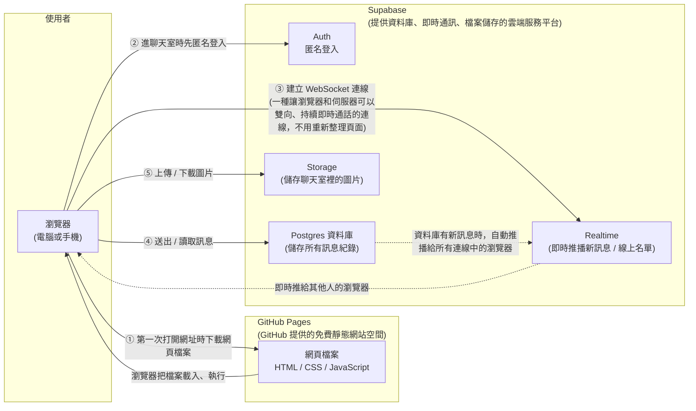
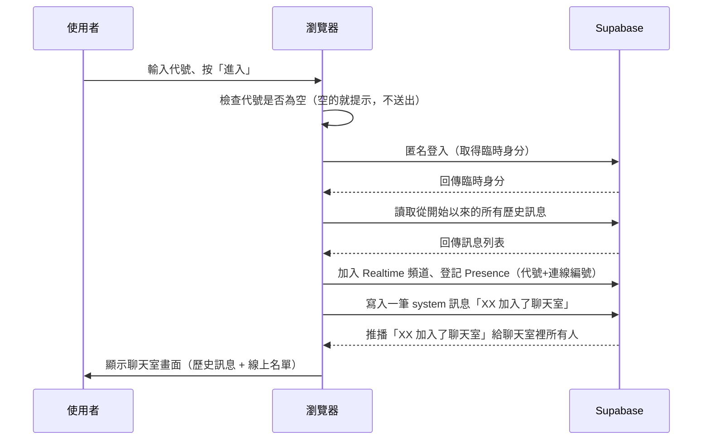
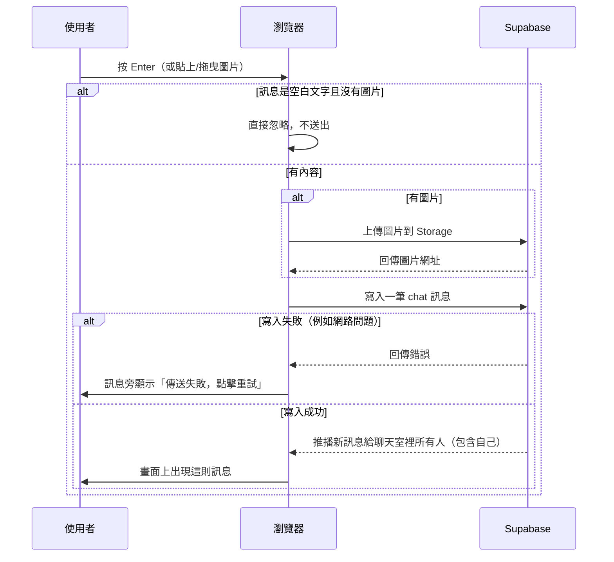
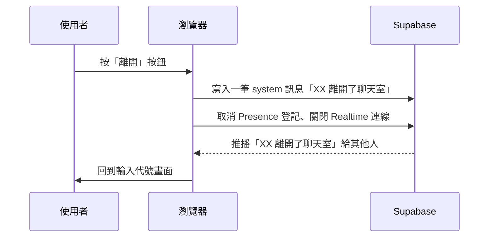
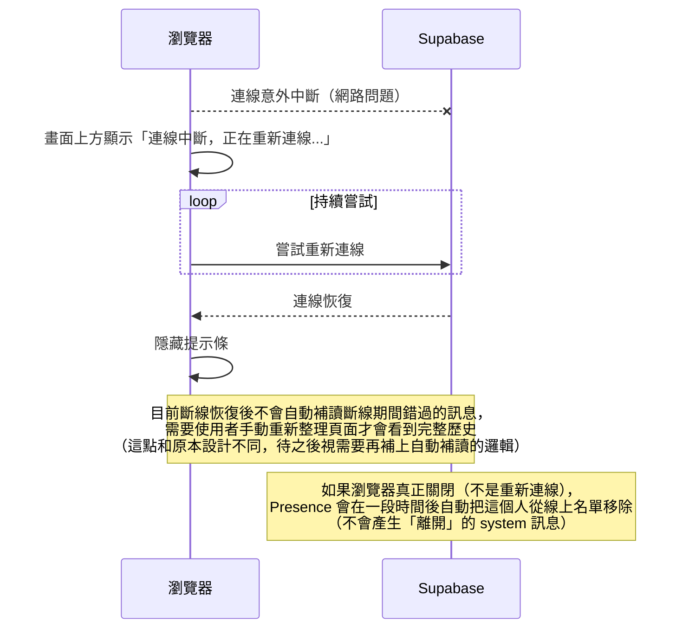

# 架構文件：匿名聊天室

> 這份文件給不寫程式的人看，專有名詞第一次出現時會用括號加一句話解釋。

---

## 1. 專案說明與目標

這是一個**不用註冊、不用登入**的匿名聊天室網站。任何拿到連結的人，打開網頁、輸入一個代號，就可以進入同一個聊天室，看到其他人的訊息、送出自己的訊息，也能看到誰在線上、誰進來誰離開。

目標：
- 任何人（電腦或手機）打開連結就能用，不需要安裝任何東西、不需要帳號密碼。
- 訊息是「即時」的（realtime，意思是不用重新整理網頁，新訊息會自動跳出來）。
- 網站本身**免費架設**：網頁放在 GitHub Pages（GitHub 提供的免費靜態網站空間），即時通訊和資料儲存用 Supabase（一個提供資料庫、即時推播、檔案儲存等服務的平台，也有免費額度）。
- 分兩階段做：先把畫面和操作做好、能在 GitHub Pages 上看到效果，最後才接上 Supabase 變成真的能跟別人即時聊天。

---

## 2. 整體架構圖



**怎麼看這張圖：**
1. 使用者打開網址，瀏覽器向 GitHub Pages 下載網頁檔案（這一步跟看任何一般網站一樣）。
2. 網頁檔案裡的程式碼開始執行，先用 Supabase 的「匿名登入」拿到一個臨時身分（使用者完全不會看到登入畫面，是自動在背景發生的）。
3. 接著瀏覽器會跟 Supabase Realtime 建立一條「WebSocket」連線，這條連線會一直開著，讓訊息可以即時雙向傳遞。
4. 使用者送出的訊息，會寫進 Supabase 的資料庫；資料庫一有新訊息，就會透過 Realtime 自動推播給所有正在連線的其他人。
5. 如果訊息帶圖片，圖片檔案本身存在 Supabase Storage，訊息裡只存一個指向圖片的網址。

整個過程中 GitHub Pages 只負責「存放並提供網頁檔案」，不會處理任何聊天邏輯——所有即時互動都是瀏覽器直接跟 Supabase 溝通。

---

## 3. 技術選擇

| 項目 | 選了什麼 | 為什麼 |
|---|---|---|
| 前端語言/框架 | **純 HTML + CSS + JavaScript**，不使用 React、Vue 等框架，也不使用 Webpack、Vite 等建置工具（build tool，意思是把原始碼「組裝、轉換」成瀏覽器能跑的檔案的工具） | GitHub Pages 只能放「靜態檔案」（寫好就能直接給瀏覽器看的檔案，不需要額外處理）。不用框架和建置工具，代表我們寫好的檔案就是瀏覽器直接執行的檔案，不需要多一道「編譯」步驟。對不寫程式的你來說，之後想請人調整內容時也單純：改檔案、存檔、上傳，不需要額外的開發環境。 |
| 身分 | **Supabase Auth 的匿名登入**（anonymous sign-in，一種不需要帳號密碼、每次連線自動產生一個臨時身分的登入方式） | 我們不想做註冊/登入畫面，但又需要一個方式讓資料庫知道「這則訊息是誰送的」，才能讓「只能編輯自己的訊息」這條規則真的被系統擋住，而不是只靠畫面假裝擋住。匿名登入在背景自動完成，使用者完全不會看到，感覺上還是「不用登入」。 |
| 即時通訊 | **Supabase Realtime**，用它的兩個功能：「Postgres Changes（資料庫異動推播）」和「Presence（在線狀態追蹤）」 | 訊息需要「永久留著、大家重新整理也還在」，所以訊息本身存進資料庫，再用 Postgres Changes 讓資料庫的新資料自動推播給大家，不用大家自己一直去問「有新訊息嗎」。線上名單則用 Presence，它是 Supabase 專門設計給「現在誰在線上」這種會隨著斷線自動消失的狀態用的功能，很適合我們「斷線一段時間自動從名單移除」的需求。 |
| 資料儲存 | **Supabase Postgres 資料庫**（Postgres 是一套資料庫系統，用來長期存放、查詢大量結構化資料） | 需要把所有訊息從聊天室開始以來永久保存，讓新加入的人可以往上捲到最開始，資料庫是做這件事最合適的工具。 |
| 圖片儲存 | **Supabase Storage**（專門用來存放檔案，例如圖片、影片的服務） | 圖片檔案不適合直接塞進資料庫（會讓資料庫肥大、變慢），Storage 是專門為這種「檔案」設計的，訊息裡只需要存一個指向圖片的網址。 |

---

## 4. 兩個階段

### 階段一：還沒接 Supabase

**要做到什麼程度：**
- 完整的畫面：輸入代號畫面、聊天室畫面（訊息列表、輸入框、線上名單、各種提示）。
- 所有操作都能「看起來」正常運作：輸入代號進房、送訊息、編輯訊息、上傳圖片、展開/收起線上名單、往上捲看歷史、新訊息提示等——但這些資料只存在**自己瀏覽器裡**（用記憶體或 localStorage，一種瀏覽器內建、可以在同一台裝置上暫時記住資料的儲存空間），不會真的跟別人同步。
- 可以模擬「有人加入/離開」「線上名單變化」等效果，讓你在這個階段就能體驗完整流程，只是對象是假資料，不是真人。

**怎麼在 GitHub Pages 上看到效果：**
把這階段寫好的 HTML/CSS/JS 檔案推上 GitHub repo，開啟 GitHub Pages 功能（細節見第 12 節），就會拿到一個網址，手機電腦都能直接打開測試這些畫面和操作。

### 階段二：接上 Supabase 之後

- 畫面和操作「看起來」幾乎一樣，但背後的資料來源換成真的 Supabase：訊息會真的傳給所有正在聊天室裡的人，線上名單是真的在線人數，重新整理頁面訊息紀錄還在。
- 新增：需要在專案裡設定 Supabase 的連線資訊（網址和公開金鑰，見第 8 節）。

### 兩階段之間，前端怎麼設計才不用整個重寫

關鍵做法是把「取得/送出聊天資料」這件事獨立成一層**固定的介面**（可以想成一張「規格書」，規定「進房」「送訊息」「編輯訊息」「上傳圖片」「離開」這幾件事分別要怎麼呼叫、會回傳什麼），畫面程式碼永遠只跟這張規格書打交道，不直接碰資料到底從哪裡來。

- 階段一提供一份「假資料版」的實作（在瀏覽器本機模擬這些功能）。
- 階段二提供一份「Supabase 版」的實作（真的呼叫 Supabase）。
- 兩份實作都照著同一張規格書做事，所以切換的時候，只需要換掉這一層，**畫面的程式碼完全不用動**。

這就像餐廳的「出餐窗口」：服務生（畫面）永遠只從窗口拿菜，不管後面是「練習用的模擬廚房」（階段一）還是「真的廚房」（階段二），服務生的動作都一樣。

---

## 5. 通訊約定

### 5.1 訊息的資料格式（存在資料庫裡的一筆訊息長什麼樣）

```json
{
  "id": "一個系統自動產生的唯一編號",
  "type": "chat 或 system",
  "author_id": "送訊息的人這次連線的臨時身分編號（匿名登入給的）",
  "author_name": "送訊息的人輸入的代號",
  "content": "文字內容，system 類型時是「XX 加入了聊天室」這類文字",
  "image_url": "圖片網址，沒有圖片就是空的",
  "created_at": "送出時間",
  "edited_at": "最後編輯時間，沒編輯過就是空的",
  "is_edited": "是否被編輯過，true 或 false"
}
```

- `type` 分兩種：`chat`（一般使用者送的訊息）、`system`（加入/離開的系統提示），兩種都存進同一份訊息紀錄裡，這樣捲動歷史時才會看到完整的事件順序。

### 5.2 即時事件（瀏覽器之間靠這些「事件」互相通知）

| 事件名稱 | 什麼時候發生 | 帶什麼資料 |
|---|---|---|
| `new_message` | 有人送出新訊息（含系統提示）被存進資料庫後 | 一筆完整的訊息資料（如上） |
| `message_updated` | 有人編輯了自己的訊息 | 更新後的那一筆訊息資料 |
| `presence_join` | 有人的瀏覽器連上了聊天室 | 代號、連線編號 |
| `presence_leave` | 有人按了離開按鈕，或斷線超過自動移除的時間 | 連線編號 |

這幾個事件都是 Supabase Realtime 自動幫我們處理的機制（資料庫有新資料、或 Presence 狀態一變化，就自動發出事件），我們不需要自己架設額外的伺服器來發送這些通知。

---

## 6. 資料流

### 6.1 進入聊天室



### 6.2 送出訊息



### 6.3 離開



### 6.4 斷線重連



---

## 7. 畫面清單

> 這裡只列「有哪些元素、元素會做什麼」，不規定顏色、字體、版面美感，那是 `/design` 要處理的事。

### 畫面 A：輸入代號

| 元素 | 行為 |
|---|---|
| 代號輸入框 | 最多輸入 20 個字；留空按「進入」時顯示提示文字，要求輸入代號 |
| 「進入」按鈕 | 代號有效時，帶使用者進入聊天室畫面 |

### 畫面 B：聊天室

| 元素 | 行為 |
|---|---|
| 訊息列表 | 由上到下依時間排列，每則顯示代號、內容（文字和/或圖片其中一種）、時間；自己送出且在 5 分鐘內的訊息旁有「編輯」小按鈕；被編輯過的訊息顯示「（已編輯）」；加入/離開是插在列表中的提示文字（不是獨立樣式的訊息），可以一路往上捲到最初的訊息 |
| 編輯中的訊息 | 點擊「編輯」後，該則訊息原地變成可編輯的輸入框，可重新輸入後送出；「編輯」按鈕本身不會因為時間經過而自動消失，實際的「送出後 5 分鐘內才能編輯」是由資料庫的 RLS 規則把關（見第 8、9 節），超過時間還是點了編輯、送出，會被資料庫拒絕 |
| 「回到底部」提示 | 使用者往上捲動看歷史時，若收到新訊息不會自動捲動，而是出現一個「有新訊息，點擊回到底部」的按鈕；點了才捲到最新訊息；使用者本來就在底部時則自動捲動 |
| 訊息輸入框 | 可輸入文字（不限字數），支援多行（Shift+Enter 換行）；按 Enter 送出；輸入框旁有上傳圖片按鈕，也支援把圖片拖曳進輸入框或用 Ctrl+V 貼上；文字訊息和圖片訊息分開送出（一則訊息只會是純文字或純圖片） |
| 傳送失敗提示 | 某則訊息沒送出成功時，旁邊顯示「傳送失敗，點擊重試」，點擊後重新嘗試送出同一則內容 |
| 線上名單（電腦版） | 固定顯示在畫面上，列出目前在線的所有代號 |
| 線上名單（手機版） | 預設收起，有一個按鈕/圖示，點擊後展開/收起名單 |
| 「離開」按鈕 | 點擊後離開聊天室，回到畫面 A，並讓其他人看到「XX 離開了聊天室」的提示 |
| 斷線提示條 | 自己的連線意外中斷時，畫面上方出現「連線中斷，正在重新連線...」，恢復連線後自動消失 |

---

## 8. 金鑰

Supabase 會給這個專案兩種金鑰（金鑰可以想成「用來證明身分、取得存取權限的一串密碼」），這兩種的「能不能公開」完全不同，一定要分清楚：

| 金鑰 | 能不能公開 | 說明 |
|---|---|---|
| **anon public key**（匿名公開金鑰） | **可以公開，設計上就是要給瀏覽器用的** | 這是給前端網頁用的金鑰，任何人打開瀏覽器的開發工具都看得到它，這是正常、預期的事。真正的安全保護不是靠「藏住這個金鑰」，而是靠資料庫的「RLS 規則」（Row Level Security，一種直接設定在資料庫層級的存取權限規則，規定「誰可以讀/寫哪些資料」），這點在第 9 節會說明。 |
| **service_role key**（服務角色金鑰） | **絕對不能出現在前端網頁、絕對不能 commit 進 GitHub** | 這個金鑰可以繞過所有安全規則，直接存取/修改資料庫裡任何資料。**這個專案不需要用到它**——因為我們完全沒有自己的後端伺服器，所有邏輯都靠前端 + RLS 規則完成。只要你從頭到尾都不把這個金鑰貼進任何程式碼，就不會有洩漏風險。 |

**怎麼產生：** 到 Supabase 專案的後台（網頁介面）「Settings → API」頁面，裡面會列出這個專案的網址（Project URL）和 anon public key，直接複製貼上即可，不需要自己「產生」任何東西。

**放在哪裡：** 專案裡會有一個 `js/config.js` 檔案，裡面只放「Project URL」和「anon public key」這兩個值。因為這兩個值本來就設計成可以公開，所以**直接 commit 進 GitHub repo 是沒問題的**（這也是因為 GitHub Pages 只能放純靜態檔案，沒有辦法在「部署時才注入機密」這種機制，就算想藏也藏不住，所以乾脆用「反正它本來就該公開」的金鑰）。

**怎麼避免不該公開的東西被 commit：** 專案裡不會有任何地方用到 service_role key，所以根本不會有這個檔案存在。養成習慣：**任何金鑰如果開頭顯示自己是 `service_role`，就絕對不要貼進這個專案的任何檔案裡。**

---

## 9. 安全與限制

### 9.1 別人可能會送什麼奇怪的東西進來，前端要怎麼擋

| 風險 | 說明（第一次出現的名詞解釋） | 怎麼擋 |
|---|---|---|
| 洗版 / 瘋狂連續送訊息 | — | 資料庫端設定「每個身分幾秒內最多送幾則訊息」的規則（RLS 規則可以做到），超過就擋下來，前端也可以在按下送出後短暫鎖住輸入框，減少誤觸 |
| 塞進惡意程式碼的文字（XSS，Cross-Site Scripting，一種把可執行的程式碼偽裝成一般文字訊息，想辦法讓它在別人瀏覽器裡被執行的攻擊方式） | 例如有人在訊息裡打 `<script>...</script>` | 前端把使用者輸入的內容一律當作「純文字」顯示，不把它當成網頁程式碼來解讀（這是網頁開發的標準做法），這樣就算有人輸入這類內容，也只會被當成一串無害的文字顯示出來 |
| 上傳過大或不是圖片的檔案 | — | 前端在選擇檔案時先檢查檔案類型（只接受圖片格式）和大小（例如限制在幾 MB 以內），資料庫端的 Storage 規則也會再做一次同樣的檢查，確保就算有人跳過前端直接呼叫 Supabase，還是會被擋下來 |
| 冒充別人的代號 | 匿名聊天室本來就無法防止「代號重複」，這是設計上接受的事（已在需求討論中確認） | 不處理，屬於這個系統設計上允許的事 |
| 偽造編輯/刪除別人的訊息 | — | 靠第 8 節提到的 RLS 規則：資料庫層級直接規定「只有這則訊息原本的作者身分，且在送出後 5 分鐘內，才能修改這一筆資料」，就算有人繞過前端畫面直接發請求，資料庫也會拒絕 |

### 9.2 免費方案要注意的上限

Supabase 和 GitHub Pages 都有免費方案，但免費額度可能隨官方政策調整，實際數字請在上線前到各自官網確認最新資訊。以目前的大致情況提醒幾個要注意的方向：

- **Supabase 資料庫容量**：免費方案的資料庫總容量有上限（通常是幾百 MB 等級），聊天訊息是純文字，累積很慢，短期內不太會超過，但長期要留意。
- **Supabase 檔案儲存容量**：圖片會比文字佔用空間快很多，免費方案的 Storage 容量也有上限，如果聊天室很熱絡、常常傳圖，要留意用量。
- **Supabase Realtime 同時連線數**：免費方案對「同時在線的 WebSocket 連線數」有上限，如果同時使用的人數非常多，可能會超過。
- **Supabase 專案閒置暫停**：免費方案的專案如果一段時間完全沒人使用，官方可能會自動暫停專案，需要手動到後台喚醒才能恢復使用。
- **GitHub Pages 流量與頻率限制**：GitHub Pages 本身對流量和更新頻率也有一些使用限制，一般的個人專案使用量通常不會碰到，但如果網站突然爆紅，需要留意。

---

## 10. 這一版刻意不做的事

| 不做的事 | 為什麼 |
|---|---|
| 帳號註冊/登入 | 需求明確是「匿名、免登入」 |
| 刪除訊息 | 需求確認只需要「編輯」，不需要「刪除」 |
| 連結預覽卡片（抓網頁標題、縮圖） | 需求確認只要網址變成可點擊文字即可，抓取網頁資料需要額外的服務，增加複雜度但不是這版的重點 |
| 多個聊天室/頻道 | 需求明確是「所有人在同一個聊天室」 |
| 私訊 | 沒有在需求裡提到，且需要額外的身分辨識機制 |
| 內容審查/髒話過濾 | 沒有在需求裡提到；要做好需要額外的詞庫或 AI 判斷服務 |
| 已讀/未讀狀態 | 沒有在需求裡提到，群聊場景下意義也不大 |
| 推播通知（手機跳通知） | 需要額外的服務（例如瀏覽器推播權限、行動 App），這版只是網頁 |
| 離線使用（PWA，一種讓網頁可以像 App 一樣離線運作、安裝到手機桌面的技術） | 聊天室本質需要即時連線，離線沒有意義 |
| 訊息搜尋 | 沒有在需求裡提到 |

---

## 11. Repo 的資料夾結構

```
/（repo 根目錄）
├── index.html              — 整個網站只有這一個網頁，用 JavaScript 切換「輸入代號」和「聊天室」兩種畫面
├── css/
│   └── style.css           — 畫面樣式（/design、/frontend-design 階段會實際決定內容）
├── js/
│   ├── main.js              — 程式進入點：啟動畫面切換、串接下面的各個模組
│   ├── ui.js                — 負責畫面上的顯示/更新（渲染訊息列表、線上名單等）
│   ├── chat-service.js      — 定義「聊天服務」該有哪些功能的規格（第 4 節提到的「出餐窗口」）
│   ├── mock-chat-service.js — 階段一用：在瀏覽器本機模擬聊天功能，不連 Supabase
│   ├── supabase-chat-service.js — 階段二用：真正呼叫 Supabase 的實作
│   └── config.js            — 階段二用：放 Supabase 的 Project URL 和 anon public key
├── supabase/
│   └── schema.sql           — 階段二用：建立資料表、RLS 規則、Storage 設定的 SQL，貼到 Supabase 後台 SQL Editor 執行
├── docs/
│   ├── requirements.md      — 需求說明（已存在）
│   ├── architecture.md      — 這份文件
│   └── design.md            — `/design` 階段決定的視覺風格與畫面細節，對應第 7 節「畫面清單」
└── README.md                — 專案簡介、怎麼本機打開測試
```

---

## 12. 部署到 GitHub Pages 的方式

1. 把整個專案的檔案 commit、push 到 GitHub repo 的 `main` 分支。
2. 到這個 repo 的網頁上，點選「Settings」。
3. 左側選單找到「Pages」。
4. 在「Build and deployment」底下的「Source」選擇「Deploy from a branch」，Branch 選 `main`、資料夾選 `/ (root)`。
5. 儲存後，GitHub 會自動產生一個網址（通常是 `https://<你的帳號>.github.io/<repo 名稱>/`），等個一兩分鐘就能打開。
6. 之後每次把新的檔案 push 到 `main` 分支，GitHub Pages 會自動重新部署，不需要額外操作。

因為這個專案完全沒有建置步驟（沒有用框架、沒有用建置工具），上傳的檔案就是瀏覽器直接執行的檔案，所以部署流程非常單純，不需要額外設定「編譯」相關的步驟。

---

## 13. 驗證清單

### 階段一（還沒接 Supabase）要測的項目

- [ ] 打開網址後看到「輸入代號」畫面
- [ ] 代號留空按「進入」會出現提示，不會進入聊天室
- [ ] 輸入超過 20 字的代號會被擋住/截斷
- [ ] 輸入有效代號後，進入聊天室畫面
- [ ] 可以送出文字訊息，畫面上出現自己的訊息（代號+內容+時間）
- [ ] 空白訊息按 Enter 不會送出任何東西
- [ ] Shift+Enter 可以在輸入框裡換行，Enter 才是送出
- [ ] 可以用按鈕選圖片、拖曳圖片、貼上圖片三種方式送出圖片訊息
- [ ] 自己 5 分鐘內的訊息旁有「編輯」按鈕，點擊後可以修改內容，修改後顯示「（已編輯）」
- [ ] 模擬「有人加入/離開」時，列表中會插入對應提示文字
- [ ] 手機版畫面：線上名單預設收起，點擊按鈕可展開/收起
- [ ] 電腦版畫面：線上名單固定可見
- [ ] 往上捲動看歷史訊息時，模擬收到新訊息不會自動跳到底部，而是出現「回到底部」提示，點擊後才捲動
- [ ] 按「離開」按鈕會回到「輸入代號」畫面
- [ ] 整個網站成功部署在 GitHub Pages 的網址上，手機和電腦都能打開操作

### 階段二（接上 Supabase 之後）要額外測的項目

- [ ] 兩個不同裝置（或兩個不同瀏覽器視窗）同時打開聊天室，各自輸入不同代號
- [ ] 其中一邊送出訊息，另一邊**不需要重新整理**就能即時看到
- [ ] 其中一邊編輯自己的訊息，另一邊能即時看到「（已編輯）」更新
- [ ] 一方加入/離開聊天室時，另一方能即時看到對應提示文字
- [ ] 重新整理頁面後，捲到最上面仍能看到最初的歷史訊息（代表訊息真的存進資料庫，不是只存在瀏覽器裡）
- [ ] 關掉瀏覽器分頁（不按離開按鈕），過一段時間後，其他人畫面上的線上名單會自動把這個人移除
- [ ] 嘗試用瀏覽器開發工具直接呼叫資料庫，修改別人的訊息或超過 5 分鐘的自己的訊息，確認會被拒絕（驗證 RLS 規則真的有效，不是只靠畫面擋）
- [ ] 刻意斷網一段時間再恢復，確認畫面上方出現「連線中斷，正在重新連線...」提示，恢復後自動消失，並補上斷線期間錯過的訊息
- [ ] 送出訊息時刻意斷網，確認該則訊息顯示「傳送失敗，點擊重試」，重試後能成功送出
- [ ] 確認 `js/config.js` 裡只有 Project URL 和 anon public key，整個專案任何地方都沒有出現 service_role key
